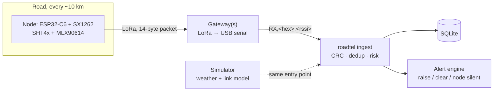
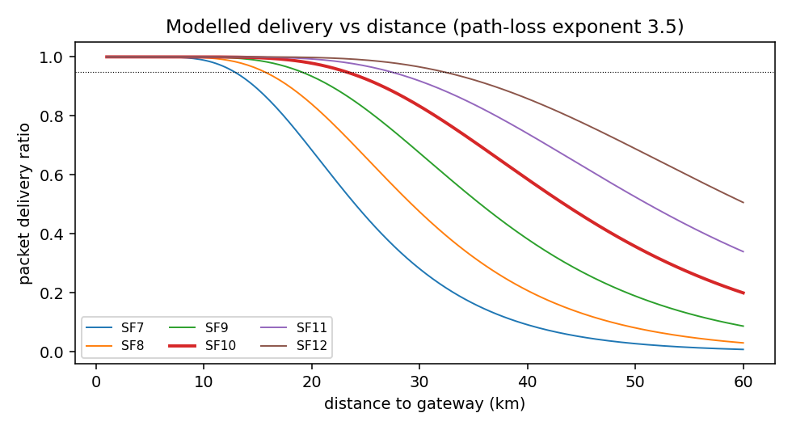
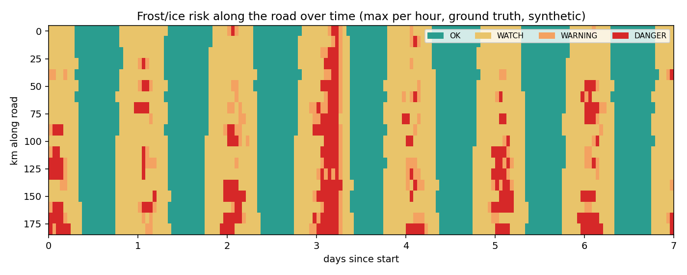
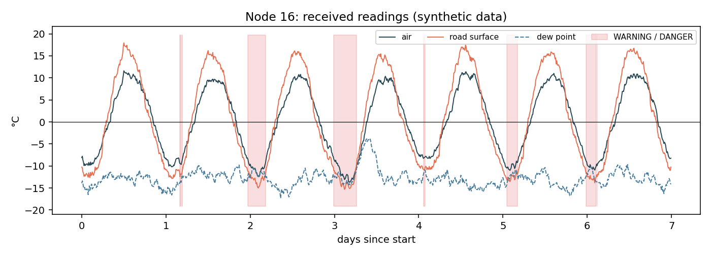

# altiplano-road-telemetry

LoRa telemetry for **frost and ice risk on a high-altitude road**: a compact packet format, a link-budget
model, a synthetic-road simulator, and an ingestion pipeline (validate → de-duplicate → store → alert).

This is the second iteration of my 2019 undergraduate thesis in telecommunications engineering
(*prototype of a road-humidity detection and monitoring system, Patacamaya–Tambo Quemado, La Paz–Oruro*).
The original used an Arduino UNO, a SIM900 GPRS module, a free PHP/MySQL host and an Android app.
This version redesigns it around LoRa and a testable software pipeline.

> **Status: software validated in simulation, hardware not yet built.**
> Every result below comes from a simulator with *assumed* radio and climate parameters. It shows the
> pipeline logic works end to end; it is **not** a field measurement of LoRa range or road conditions.
> See [What is and is not verified](#what-is-and-is-not-verified).

## What changed since 2019

| | 2019 thesis | This version |
|---|---|---|
| Uplink | GSM/GPRS (SIM900, 2G) over a mobile plan | LoRa (SX1262), no per-node data plan |
| Node | Arduino UNO + SIM900 shield | ESP32-C6 + SX1262 (M5Stack Unit C6L) |
| Sensors | SHT10 + YL-83 rain board | SHT4x (air T/RH) + MLX90614 (road-surface IR temperature) |
| What it decides | humidity percentage | dew point vs. surface temperature → frost/ice risk level |
| Backend | PHP + MySQL on a free host | Python ingestion, SQLite (swap-in point for Postgres/Influx) |
| Data integrity | none | application CRC-16, duplicate suppression across gateways |
| Testing | manual, on the bench | 41 automated tests + reproducible simulation |
| Coverage question | drive test of operator signal | link-budget model → gateways needed for 180 km |

Why the sensor change: air humidity alone does not tell you whether the road is slippery. Ice forms when the
*surface* is at or below freezing and at or below the dew point, so the node measures both.

## Architecture



The simulator feeds the *same* `Ingestor.handle()` that real gateway data would, so the whole pipeline is
exercised without hardware.

## Packet format (14 bytes)

| offset | size | field |
|---|---|---|
| 0 | 1 | version (high nibble) · flags (low nibble) |
| 1 | 1 | node id |
| 2 | 2 | sequence number |
| 4 | 2 | air temperature, 0.01 °C (signed) |
| 6 | 2 | relative humidity, 0.01 % |
| 8 | 2 | road surface temperature, 0.01 °C (signed) |
| 10 | 2 | battery, mV |
| 12 | 2 | CRC-16/CCITT-FALSE |

A short packet matters: at SF10/125 kHz it is about 289 ms on air. Python implementation:
[`packet.py`](src/roadtel/packet.py); firmware implementation: [`packet.h`](firmware/include/packet.h);
both are pinned to one frozen test vector.

## Risk model

[`physics.py`](src/roadtel/physics.py) computes the dew point (Magnus formula) and classifies each reading:

| level | rule (surface temperature `Ts`, dew point `Td`) |
|---|---|
| DANGER | `Ts ≤ 0 °C` and `Ts ≤ Td + 0.5` → frost or ice likely |
| WARNING | `Ts ≤ 2 °C` and `Ts − Td ≤ 1.5` → cold and moist, close to freezing |
| WATCH | `Ts ≤ 3 °C` |
| OK | otherwise |

These thresholds are a transparent heuristic, **not calibrated** against pavement data. If the IR sensor
fails, the node sets a flag and the pipeline falls back to `air − 2 °C`. Alerts are raised on entering
WARNING or worse, and cleared only after two consecutive safer readings so a reading hovering at a
threshold does not flap.

## Link budget: how many gateways for 180 km?

The model ([`linkbudget.py`](src/roadtel/linkbudget.py)) is free-space loss at 1 km plus a log-distance
term, Gaussian shadowing and fading, SX126x-typical sensitivities, 915 MHz, 20 dBm, 0 dBi antennas and 3 dB
system loss. The path-loss exponent is the dominant unknown, so here are three values
(`roadtel link-budget --exponent N`):

| SF | airtime | range @95 %, n = 3.0 | n = 3.5 (default) | n = 4.2 |
|---|---|---|---|---|
| 7 | 46 ms | 19.6 km | 12.8 km | 8.4 km |
| 10 | 289 ms | 39.0 km | 23.1 km | 13.7 km |
| 12 | 1155 ms | 57.3 km | 32.1 km | 18.0 km |

Gateways needed to cover 180 km at SF10: **3 / 4 / 7** for n = 3.0 / 3.5 / 4.2. In other words the design
cost is very sensitive to a number only a field test can pin down. Each gateway also needs power and a
backhaul to the internet, which is the real constraint on a remote road.



## Simulation results

`roadtel simulate` runs 19 nodes (every 10 km) for 7 days at one report per 10 minutes, SF10, with
4 gateways planned from the link budget, and a cold front on day 3.
Numbers are in [`docs/results.json`](docs/results.json).

| metric | value |
|---|---|
| transmissions | 19,152 |
| delivered to at least one gateway | 99.5 % |
| readings stored (after de-duplication) | 19,056 |
| duplicate copies dropped (heard by 2+ gateways) | 14,194 |
| corrupted packets rejected by the CRC | 167 |
| stored risk level equals ground-truth level | 99.97 % |
| WARNING+ episodes with an alert active | 195 / 195 |

The delivery number is high **by construction**: gateways were planned to cover the road at 95 % link
probability under the same model that simulates the radio. It tests the pipeline, not the radio. The
alert-timing result is also modest: worst-case detection delay is one report interval (10 min) plus
airtime, since a node only reports periodically.




## Quick start

```bash
pip install -e ".[report,dev]"
pytest                                   # 41 tests
roadtel link-budget                      # range / airtime / gateways per spreading factor
roadtel simulate --db data/sim.db        # 7-day synthetic scenario
roadtel report --db data/sim.db --out docs
```

With a real gateway flashed with `firmware/gateway/gateway.ino`:

```bash
pip install -e ".[serial]"
roadtel serial --port COM5 --db data/live.db
```

## Repository layout

```
src/roadtel/      packet · physics · linkbudget · simulator · ingest · alerts · storage · metrics · report · cli
tests/            41 tests (wire format, physics, link budget, ingestion, alerts, end-to-end simulation)
firmware/         node + gateway sketches, shared packet.h, host-side C++ test
docs/             generated figures and results.json
```

## What is and is not verified

**Verified (automated tests, run locally):**
- Packet encode/decode, including that every single-bit corruption is caught by the CRC.
- CRC-16 against the standard check value; LoRa airtime against Semtech's published formula (41.2 ms at SF7, 10 bytes).
- Dew point against reference values; risk-level rules; alert raise / escalate / clear logic; duplicate handling.
- The full simulate → ingest → metrics pipeline, including determinism for a fixed seed.

**Not verified:**
- **Firmware has never been compiled or run on hardware.** The pin map in `board_pins.h` is taken from a
  retailer's product page that contradicts itself (the same GPIOs listed for the radio and the display) and
  must be checked against M5Stack's own documentation. `firmware/test/test_packet.cpp` checks the C++
  encoder against the Python vector, but I have not run it yet.
- LoRa range at 4,000+ m on real terrain. The path-loss exponent is an assumption.
- The ice/frost thresholds against real pavement behaviour.
- The altitude profile and weather in the simulator are rough illustrations, not data from the real road.
- Operating band and power limits: check your national regulator before transmitting.

## Roadmap

1. Build two nodes + one gateway; measure RSSI vs distance and fit the real path-loss exponent.
2. Replace SQLite with Postgres/Timescale or InfluxDB and add a Grafana dashboard.
3. Solar + battery sizing for sub-zero nights; measure real sleep current.
4. Try Meshtastic as a zero-code mesh baseline and compare.
5. Calibrate the risk thresholds against logged road-surface observations.

## License

MIT
